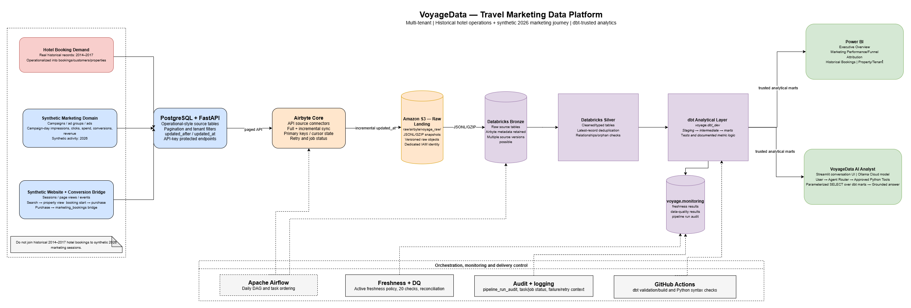
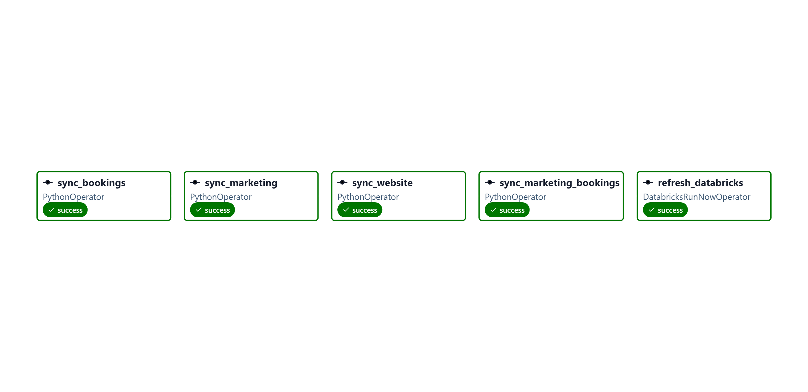
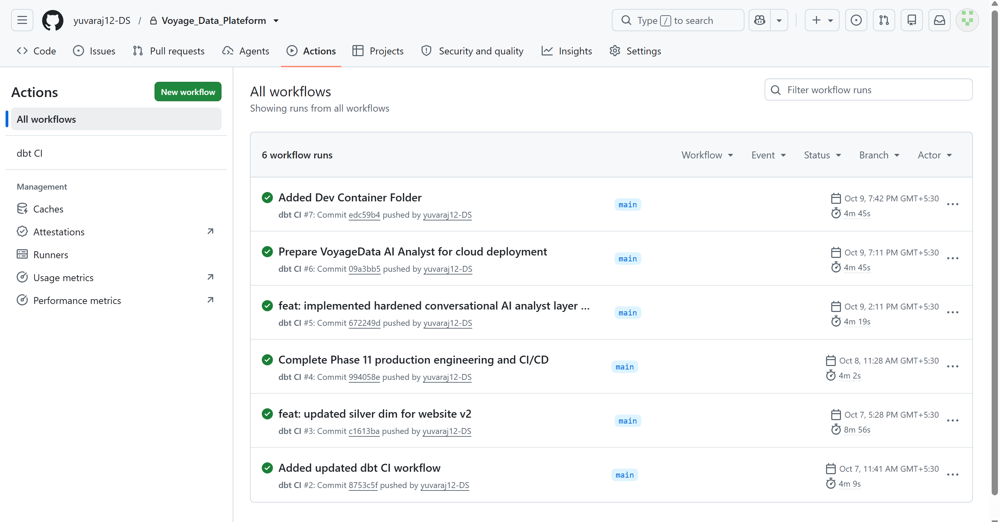

# VoyageData - Travel Marketing Data Platform

> Portfolio project: I built an end-to-end, multi-domain data platform for travel marketing and hotel-booking analytics, covering batch ingestion, lakehouse architecture, dbt analytics, BI, orchestration, monitoring, CI, and a controlled conversational AI analyst.
>
> ### 'Status': I completed the full project, validated the major phases, and finalized the portfolio-ready implementation.

## Contents

- [1. Project objective](#1-project-objective)
- [2. Business questions](#2-business-questions)
- [3. Architecture at a glance](#3-architecture-at-a-glance)
- [4. Critical data-design decisions](#4-critical-data-design-decisions)
- [5. Data domains and source strategy](#5-data-domains-and-source-strategy)
- [6. Technology stack](#6-technology-stack)
- [7. Repository structure](#7-repository-structure)
- [8. Phase-by-phase delivery](#8-phase-by-phase-delivery)
- [9. Analytical layer and core metrics](#9-analytical-layer-and-core-metrics)
- [10. Data quality, freshness, and operations](#10-data-quality-freshness-and-operations)
- [11. Local development and reproduction](#11-local-development-and-reproduction)
- [12. Airflow operations](#12-airflow-operations)
- [13. dbt and GitHub Actions](#13-dbt-and-github-actions)
- [14. Power BI](#14-power-bi)
- [15. VoyageData AI Analyst](#15-voyagedata-ai-analyst)
- [16. Troubleshooting notes and lessons learned](#16-troubleshooting-notes-and-lessons-learned)
- [17. Security and limitations](#17-security-and-limitations)
- [18. Validation evidence](#18-validation-evidence)
- [19. Roadmap and release checklist](#19-roadmap-and-release-checklist)
- [20. References](#20-references)

---

## 1. Project objective

I built VoyageData to simulate the analytical platform of a travel company that manages multiple properties and relies on digital advertising to drive website traffic and bookings. The business challenge was to combine historical hotel-booking data with current campaign performance, website behavior, conversion events, and revenue attribution in a way that could be trusted, monitored, and consumed by both analysts and an AI-driven data assistant.

I designed the project to demonstrate a full data-engineering and analytics lifecycle:

1. I turned historical source data into an operational-style booking API backed by PostgreSQL.
2. I ingested operational records incrementally with Airbyte and landed raw snapshots in Amazon S3.
3. I processed the raw data into Bronze and Silver lakehouse layers in Databricks.
4. I built tested, documented analytical models with dbt.
5. I added synthetic marketing, website, and marketing-booking domains to represent a measurable 2026 customer journey.
6. I used Power BI to answer business questions through a dimensional and semantic model.
7. I orchestrated ingestion, transformation, and checks with Airflow.
8. I added freshness monitoring, data-quality checks, run auditing, structured logging, and GitHub Actions CI.
9. I added a conversational AI analyst using Streamlit, Ollama Cloud, approved Python tools, parameterized Databricks SQL, and trusted dbt marts.

The goal was not simply to show a dashboard or chatbot. I built a platform that demonstrates how operational data becomes governed analytics, how the pipeline is monitored, and how a user-facing application can consume trusted data without bypassing the business logic.

## 2. Business questions

### Marketing performance

- How much did we spend over a selected period?
- Which campaign or channel generated the most clicks or revenue?
- What were CTR, CPC, website conversion rate, cost per booking, and ROAS?
- Which tenant or campaign performed best, and over what period?

### Website and conversion funnel

- How many sessions and page views occurred?
- How many sessions progressed through searches, property views, and booking starts?
- How many website purchase or conversion events occurred?
- At which stage did the largest drop-off occur?

### Attribution

- How did attributed revenue compare under first-click, last-click, and linear attribution?
- Which campaigns received attributed bookings, gross booking value, or net revenue?
- What revenue remained unattributed because no eligible paid-campaign touchpoint existed within the defined lookback window?

### Historical booking analytics

- What were the booking, cancellation, completion, and room-night trends from the historical hotel-booking dataset?
- Which properties and tenants had the highest booking volume or completed-booking value?
- How did cancellation rates vary by year or property?

### AI-assisted analytics

- Could a user ask these questions in natural language?
- Could the application select an approved query tool, retrieve actual results, and explain them without inventing numbers or allowing unrestricted SQL?
- Could each answer identify its source mart, date window, and relevant filters?

## 3. Architecture at a glance

I implemented a platform with two consumption paths: Power BI for interactive dashboards and the VoyageData AI Analyst for conversational analytics, both over the same trusted dbt analytical layer.



This is the logical architecture of the platform. The exact deployment boundary differs by component. I ran Airbyte and Airflow locally using Docker and Kubernetes tooling, PostgreSQL and FastAPI served the API locally, AWS S3 served as the raw landing zone, Databricks hosted the Bronze/Silver/analytical tables, and Power BI consumed the analytical marts.

## 4. Critical data-design decisions

### 4.1 Historical and synthetic timelines remain separate

- The hotel-booking dataset contains real historical records, primarily for 2014-2017.
- Marketing campaigns, website sessions, events, and the marketing-booking bridge are synthetic 2026 data.
- I did not join 2014-2017 hotel bookings to synthetic 2026 website sessions or campaign IDs. Such a join would incorrectly imply a real customer journey that the data does not support.
- The `marketing_bookings` table is a separate synthetic conversion/booking bridge that links eligible website purchase events with campaign-touchpoint analytics.

This separation preserved data integrity and allowed me to support two valid analytical stories: historical hotel operations and synthetic end-to-end marketing attribution.

### 4.2 Multi-tenancy is represented explicitly

Tenant identifiers flow through operational entities, campaign and website domains, and analytical facts. I used tenant-aware keys and filters wherever supported. I also treated the public AI deployment as a demo environment rather than a secure multi-tenant service until authentication and tenant authorization were implemented and tested.

### 4.3 Bronze, Silver, and dbt analytical models have different jobs

- **Bronze:** raw records landed from S3, including multiple Airbyte versions where applicable.
- **Silver:** cleaned, typed, deduplicated records; latest current records selected using update or extraction timestamps; referential checks performed.
- **dbt analytical layer (`voyage.dbt_dev`):** tested facts and dimensions used by BI and AI. This is the trusted consumption layer. I kept the dbt schema separate from `voyage.silver` to avoid collisions.

### 4.4 Marketing metrics have explicit grains

- `fct_campaign_daily`: one row per date, tenant, and campaign.
- `fct_marketing_funnel_daily`: one row per date, tenant, and campaign; includes impressions, clicks, spend, website funnel metrics, and attributed booking/revenue measures.
- `fct_marketing_attribution_daily`: one row per date, tenant, campaign, and attribution model.
- `fct_website_daily`: daily website activity by tenant and traffic dimensions such as source, medium, and campaign.

I retained ad groups and ads as separate dimensions. I did not join them to campaign-day metrics unless their metrics matched the correct grain, because joining them at the wrong grain would fan out and duplicate measures.

## 5. Data domains and source strategy

### 5.1 Historical hotel-booking domain

I used the Kaggle Hotel Booking Demand dataset as the historical booking source. The original snapshot contained 119,390 rows and 32 columns. I rejected a negative ADR record from the operational booking records rather than silently converting it into a plausible value, and I retained it in a rejection/audit path. The implemented snapshot contained 119,389 customers, 119,389 bookings, two tenants, two properties, and one booking rejection. These counts can vary if the source is regenerated or replaced, so I documented them in the validation log.

I built an operational-style schema around tenants, properties, customers, bookings, and booking rejections. I derived `booking_date` from arrival date minus `lead_time`, and I derived booking status from the source cancellation and checkout logic. I also generated stable identifiers for tenants, properties, customers, and bookings.

### 5.2 Marketing domain - synthetic 2026

I created the marketing API to provide campaigns, ad groups, ads, and daily campaign performance. At the initial checkpoint, the generator created six campaigns, 12 ad groups, 24 ads, and 1,098 campaign-day metric rows for 2026-04-01 through 2026-09-30. I later added daily append scripts, so current row counts can be higher than the initial checkpoint.

The raw daily metrics included impressions, clicks, spend, conversions, revenue, tenant and campaign identifiers, and `updated_at`. Rates such as CTR, CPC, conversion rate, and ROAS were modeled downstream in dbt and consumed using clearly defined business logic.

### 5.3 Website domain - synthetic 2026

I built the website domain to contain sessions, page views, and events. The funnel includes search availability, view property, begin booking, and purchase. Paid sources can carry a campaign ID, while non-campaign traffic can have a null campaign ID. I validated timestamps and foreign keys so that events belonged to the appropriate sessions and tenants.

At the initial checkpoint, the generator created 30,000 sessions, 111,408 page views, and 24,786 events. I later introduced daily append scripts to keep the active website data fresh for the daily pipeline. These counts were checkpoints, not permanent totals.

### 5.4 2026 marketing-booking bridge and attribution

I created a `marketing_bookings` row for each website purchase or conversion event. The bridge includes a unique booking ID and conversion ID and preserves relationships such as tenant, session, user, property, booking date, booking status, gross booking value, and net revenue. Under the implemented generator contract, one booking is expected per purchase event.

At the initial attribution checkpoint, there were 1,590 marketing bookings with total net revenue of 1,914,749.50; 861 were attributable and 729 were unattributed under the defined eligible paid-touchpoint and lookback rules. First-click, last-click, and linear attributed net revenue each reconciled to 1,029,423.49 at that checkpoint. These are baseline validation figures only; daily appends may change the current totals.

## 6. Technology stack

| Layer | Technology | Role in the project |
|---|---|---|
| Operational API | FastAPI, Python | Exposed tenant, property, customer, booking, and synthetic domain APIs |
| Operational storage | PostgreSQL | Source-of-record tables for API domains |
| Ingestion | Airbyte Core | Full and incremental extraction; pagination, cursor fields, and primary keys |
| Raw storage | AWS S3 | Durable landing area for Airbyte output; versioning enabled |
| Lakehouse | Databricks, Unity Catalog | Bronze raw, Silver cleaned, and SQL-accessible analytical tables |
| Transformation | dbt Core, dbt-databricks, dbt-spark | Staging, intermediate, marts, tests, and documentation |
| Orchestration | Apache Airflow 3.x, Docker | Scheduled sequencing for ingestion, Databricks jobs, and monitoring |
| BI | Power BI | Executive, marketing, funnel, attribution, historical hotel, and tenant/property dashboards |
| AI UI | Streamlit | Conversational analytics front end |
| Model API | Ollama Cloud | Natural-language reasoning and tool selection; local Ollama was not required |
| AI data access | Databricks SQL connector | Approved, parameterized read queries over dbt marts |
| CI | GitHub Actions | dbt validation/build checks and Python syntax checks according to workflow triggers |
| Version control | Git/GitHub | Source control, reviewability, CI, and project documentation |

## 7. Repository structure

The following tree reflects the principal folders I created for the project. Some local secrets, virtual environments, Docker state, raw-data files, or Databricks workspace notebooks may exist outside the committed tree. I treated the repository as the source of truth and kept the structure aligned with the active implementation.

```text
voyage_data_platform/
 .github/
    workflows/
        dbt-ci.yml                 # GitHub Actions workflow
 api/                               # FastAPI operational API
 ai_assistant/                      # Streamlit AI Analyst and approved tools
    app.py
    agent.py
    databricks_client.py
    inspection_schema.py
    prompts.py
    schemas.py
    tools.py
    test_agent.py
    test_ollama_cloud.py
    validate_grounding.py
 data/
    raw/                      # Local/source landing area (Historical raw data)
 dbt/
    dbt_project.yml
    models/
       staging/
       intermediate/
       marts/
    tests/
    macros/
    seeds/
 docs/
    phase_1-11_baseline.md
    architecture/
    VoyageData_Complete_Project_Guide_and_Reproduction_Runbook.docx
 notebooks/ 01_dataset_profiling.ipynb                      
         /voyage_lakehouse_databricks       # Databricks engineering notebooks.
 orchestration/
    airflow/
        dags/
           voyage_daily_pipeline.py
        Dockerfile
        docker-compose.yml
        requirements.txt
        .env.airflow
 power_bi/                           # PBIX and report assets
 Scripts/                       #contains data generation and testing .py files
 tests/
 docker-compose.yml
 README.md
 .gitignore
 .env.example
 requirements-dbt-ci.txt
 requirements-ai.txt
 requiremant.txt
```

## 8. Phase-by-phase delivery

I implemented the project in phases, with each stage adding something material to the platform.

### Phase 1 - data domain and source selection

I identified the hotel-booking demand dataset as the historical source and designed the project around a sale/booking domain plus synthetic 2026 marketing and website data.

### Phase 2 - API-backed operational source

I created the PostgreSQL operational model and FastAPI endpoints for tenants, properties, customers, bookings, and synthetic domains.

### Phase 3 - Airbyte ingestion and S3 raw landing

I configured incremental extraction and raw landing in S3 so the platform could ingest both historical and synthetic domains reliably.

### Phase 4 - Databricks Bronze and Silver processing

I landed raw records in Bronze and cleaned them into Silver with typing, deduplication, and referential integrity checks.

### Phase 5 - dbt analytical marts

I built the trusted analytical layer in dbt with facts, dimensions, and tests for grain, uniqueness, relationships, and metrics.

### Phase 6 - orchestration and monitoring

I added Airflow orchestration alongside freshness checks, run auditing, and pipeline monitoring to make the platform operationally visible.

### Phase 7 - business reporting and Power BI

I developed the Power BI semantic layer and report pages for executive, marketing, funnel, attribution, and historical booking analysis.

### Phase 8 - AI analyst and tool guardrails

I built the Streamlit AI analyst, defined approved tools, constrained access to SQL, and enforced query validation and grounding checks.

### Phase 9 - CI and release packaging

I set up GitHub Actions checks and refined the repository and documentation so the project could be reviewed and reproduced consistently.

### Phase 10 - validation and final polish

I ran the validation passes, corrected logic issues, and finalized the documentation and project-quality checks to produce a complete portfolio-ready implementation.

## 9. Analytical layer and core metrics

I built the analytics layer around a set of trusted marts that support both BI and AI consumption. The key model families include:

- `fct_booking_daily`: daily historical booking facts
- `fct_campaign_daily`: daily campaign performance facts
- `fct_marketing_funnel_daily`: campaign day performance with funnel and conversion metrics
- `fct_marketing_attribution_daily`: attribution final outputs by attribution model
- `fct_website_daily`: website traffic and engagement metrics
- `fct_tenant_performance`: daily and aggregate tenant performance metrics

Core measures include:

- spend
- impressions
- clicks
- CTR
- CPC
- conversion rate
- cost per booking
- attributed bookings
- gross booking value
- net revenue
- ROAS
- cancellation rate
- room nights
- booking completion rate

These measures were modeled in dbt and consumed by both Power BI and the AI analyst. The analytical layer is the authority for business metrics. The LLM is used for language understanding and explanation, not for determining the underlying numbers.

## 10. Data quality, freshness, and operations

### 10.1 Data quality checks

I implemented a set of data-quality checks covering the main domain tables and analytical marts. These included:

- fact completeness for historical bookings, campaign performance, website activity, marketing funnel, and attribution
- property and tenant performance completeness
- campaign duplicate-grain checks
- marketing metric validity
- orphan campaign checks
- website reconciliation
- marketing reconciliation
- duplicate booking IDs and booking-to-property referential checks
- valid website event names
- date, tenant, campaign, and property dimension completeness

I validated these checks by running the project pipeline end to end and confirming that all relevant checks passed.

### 10.2 Freshness and monitoring

I integrated pipeline freshness checks and audit tables into Databricks so the platform could detect stale or missing data before downstream reporting and AI queries relied on it. The monitoring schema included:

- `voyage.monitoring.freshness_results`
- `voyage.monitoring.data_quality_results`
- `voyage.monitoring.pipeline_run_audit`

Freshness writes were designed to be idempotent per `pipeline_run_id` and dataset. `pipeline_run_audit` recorded the final status and the critical stages such as Airbyte, Databricks, dbt, DQ, and freshness. I made sure the monitoring summary reflected actual stage states rather than assuming success.

### 10.3 Operational controls

I enforced several safeguards across the platform:

- I kept dbt output in a separate analytical schema to avoid collisions with raw and Silver tables.
- I skipped downstream DQ logic when strict freshness failed so old analytical tables were not treated as fresh.
- I used idempotent writes and merge logic to prevent duplicate monitoring rows after retries.
- I logged operational metadata without exposing secrets.

## 11. Local development and reproduction

This is a multi-service project. I ran the platform from the correct working directories and environment-specific configurations. Exact local paths, connection IDs, and credential locations differ by machine, so I kept secrets in ignored files or environment variables instead of committing them.

### 11.1 Repository and Python environments

Example Windows checkout:

```powershell
cd E:\voyage_data_platform
git status
git pull --ff-only
```

I used separate virtual environments so the dbt and AI dependencies did not contaminate one another:

```powershell
# dbt environment
.\.venv-dbt\Scripts\Activate.ps1

# AI environment (run in a separate shell or after deactivating the first)
.\.venv-ai\Scripts\Activate.ps1
```

I never committed either virtual environment. I used pinned dependency files where required and kept CI dependencies isolated from the application runtime.

### 11.2 PostgreSQL and FastAPI

The API-backed PostgreSQL source was the operational entry point. I started it using the configuration and entrypoints already present in `api/` and confirmed the API responded on the expected local host and port. In this project, the booking API used port 8001 because the local Airbyte UI/API occupied port 8000.

The key endpoints included `/api/v1/tenants`, `/api/v1/properties`, `/api/v1/customers`, `/api/v1/bookings`, and the synthetic marketing, website, and marketing-booking endpoints. I used the OpenAPI docs to confirm the exact endpoints in the active checkout.

### 11.3 Airbyte and S3

I ran Airbyte locally through `abctl`, Kind/Kubernetes, and Docker. The booking API source used API-key authentication, page/page-size pagination, cursor filtering by `updated_at`, and primary keys appropriate to each stream. The S3 destination landed JSONL/GZIP records under the project's raw Airbyte path.

I did not reset Airbyte state simply to force new rows through. I inspected the API's `updated_after` responses, cursor precision, stream configuration, saved state, and destination mode before making changes.

### 11.4 Databricks and dbt

The Databricks structure I used was:

```text
voyage.bronze      raw ingested tables
voyage.silver      cleaned/deduplicated tables
voyage.dbt_dev     dbt analytical marts for BI/AI
voyage.monitoring  freshness, DQ, and audit history
```

The dbt project lived in `dbt/` and used the profile name `voyage_data_platform`. The profile configuration relied on environment variables for the workspace host, SQL warehouse HTTP path, and token. I worked through the profile naming and directory structure carefully to ensure dbt commands resolved correctly.


I validated the project using the pinned versions available at the time: dbt Core 1.12.3, dbt-databricks 1.12.5, and dbt-spark 1.10.3. I kept CI pinned to these versions instead of upgrading them during unrelated work.

Useful commands once the profile directory was configured correctly:

```powershell
# From repository root; adjust the profile directory to your local setup.
.\.venv-dbt\Scripts\python.exe -m dbt --version
.\.venv-dbt\Scripts\python.exe -m dbt debug --project-dir dbt --profiles-dir <PROFILE_DIRECTORY>
.\.venv-dbt\Scripts\python.exe -m dbt build --project-dir dbt --profiles-dir <PROFILE_DIRECTORY>
.\.venv-dbt\Scripts\python.exe -m dbt docs generate --project-dir dbt --profiles-dir <PROFILE_DIRECTORY>
```

### 11.5 Airflow

The orchestration project lived in `orchestration/airflow/`. I used the Docker Compose configuration and environment file from that folder and kept `.env.airflow` out of version control. The intended daily DAG was `voyage_daily_pipeline`, which sequenced the four Airbyte connections before triggering the Databricks job.

To inspect a local deployment, I used Docker Compose status and log commands from that directory, then checked the Airflow UI. I confirmed the connection IDs and Databricks job IDs against the active deployment before replaying or troubleshooting a run.

### 11.6 AI Analyst

The AI project lived in `ai_assistant/`. I ran the app from the repository root with:

```powershell
.\.venv-ai\Scripts\Activate.ps1
streamlit run ai_assistant/app.py
```

The assistant called Ollama Cloud and then selected an approved Python tool. That tool validated inputs, executed predefined parameterized SELECT queries against the dbt analytical marts, and returned results along with source metadata such as the table and applied filters. I restricted the language model from having raw credentials or arbitrary SQL and database-write capabilities.

I also followed the active `databricks_client.py` and configuration pattern for local secrets instead of relying on stale assumptions. For Community Cloud, I configured secrets in the app's secret settings rather than committing a secrets file.

## 12. Airflow operations

### 12.1 Daily DAG sequence

1. `sync_bookings`
2. `sync_marketing`
3. `sync_website`
4. `sync_marketing_bookings`
5. `refresh_databricks`



The Databricks job then ran:

1. `freshness_validation`
2. `dbt_build`
3. `pipeline_validation`
4. `dq_monitoring`
5. `monitoring_summary`

### 12.2 Failure behavior

- I prevented dbt builds and downstream quality checks from acting as if fresh data existed when strict freshness checks failed.
- The DQ monitoring notebook could record a SKIPPED state if freshness failed, preventing stale analytical tables from being represented as fresh-run data.
- `monitoring_summary` was configured to run after upstream tasks finished (`ALL_DONE`) so the run audit could record success or failure. This trigger rule did not mean failed upstream tasks should be ignored by the overall-status calculation.
- Retries could re-run a notebook, so I implemented idempotency keys and MERGE logic to avoid duplicate rows.
- Every Airbyte sync logged start, job ID, status, runtime, and context without exposing secrets.

## 13. dbt and GitHub Actions

The dbt project contains staging, intermediate, marts, tests, macros, and seeds. I implemented tests covering model grain and uniqueness, relationships, valid metrics, and cross-domain reconciliation. I also used `dbt docs generate` to produce model documentation site artifacts.

GitHub Actions automated checks on repository changes according to `.github/workflows/dbt-ci.yml`. I validated the workflow and confirmed the expected roles were:

- install pinned Python and dbt dependencies
- verify dbt installation and profile connectivity as configured
- compile and validate the dbt project
- run Python syntax checks for pipeline code
- build dbt models and run tests on the enabled workflow events



I reviewed the workflow triggers and conditions before documenting which events ran `dbt build`. CI used an isolated schema where appropriate and never replaced the Power BI development tables by mistake.

## 14. Power BI

The PBIX/report was stored under `power_bi/` in the repository. The report pages I implemented included:

- Executive Overview
  
- Marketing Performance
- Marketing Funnel
- Attribution
- Historical Hotel Booking Analytics
- Property/Tenant

The `_Measures` table centralized the DAX measures. Core marketing and funnel measures used `fct_marketing_funnel_daily`, attribution measures used `fct_marketing_attribution_daily`, historical hotel measures used `fct_booking_daily`, and tenant summary measures used `fct_tenant_performance`.

The disconnected `Funnel Stages` helper drove the ordered funnel display: Impressions, Clicks, Sessions, Searches, Property Views, Booking Starts, Conversions. The `Model Names` helper supported comparison across `first_click`, `last_click`, and `linear` attribution. The report explicitly distinguishes website conversions from attributed bookings when their definitions and grains differ.

## 15. VoyageData AI Analyst

### 15.1 Design

```text
Question in Streamlit
  -> agent/router
  -> validated tool arguments
  -> approved business function
  -> parameterized SQL SELECT against approved dbt marts
  -> result rows + provenance metadata
  -> model-generated explanation grounded in returned values
```


I used the LLM for language understanding, tool selection, and explanation. I did not allow it to be the authority on metric values. The SQL results from Databricks and the documented business definitions served as the ground truth.

### 15.2 Approved tool families

I designed the tool set to cover campaign performance, marketing funnel, attribution, historical booking performance, tenant performance, and other explicitly approved property and website tools implemented in code. The active tool list in `ai_assistant/tools.py` was the source of truth, and I did not document or expose tools that were not implemented.

### 15.3 Grounding and evaluation

The repository included:

- `inspection_schema.py`: inspection of available tables and columns
- `test_agent.py`: offline agent and schema validation
- `test_ollama_cloud.py`: cloud model connectivity checks
- `validate_grounding.py`: comparison of selected tool metrics with independently aggregated approved marts

I validated the grounding logic and corrected the attribution SQL aggregation issue before final verification. Before any public launch, I reran the exact checks and test questions in Streamlit against direct SQL and Power BI outputs.

### 15.4 Deployment status

I confirmed that the local Streamlit application and grounding checks were working. The Community Cloud deployment itself was a separate step and required a live deployed URL with smoke tests to confirm readiness. I followed the official Streamlit deployment guidance for app structure, deployment, and secrets management.

## 16. Troubleshooting notes and lessons learned

| Symptom | Root cause or lesson | Resolution / prevention |
|---|---|---|
| Airbyte local UI/API used port 8000 while the API needed a listener | Port conflict | I ran the FastAPI booking API on 8001 |
| Raw Airbyte records had multiple versions | Incremental extraction preserved prior versions in raw data | I deduplicated in Silver using updated/extraction timestamps instead of assuming raw row count equaled current logical records |
| dbt output collided with the Silver schema | Output schema overlapped with the lakehouse Silver layer | I kept dbt models in `voyage.dbt_dev` |
| API incremental returns were empty or reference streams returned all rows | API cursor filters, saved Airbyte state, or stream configuration required inspection | I verified the API directly using `updated_after` and confirmed cursor precision, field selection, primary keys, sync mode, and append-plus-dedupe settings |
| Website incremental sync failed to advance correctly | Cursor timestamp precision was incompatible with the source formatter | I generated `updated_at` with microseconds and kept serialization and cursor format consistent |
| Daily synthetic data went stale | Static test data did not create daily activity | I added append-only daily generator scripts and validated links and constraints |
| DQ appeared to validate old marts after freshness failed | Freshness and DQ tasks needed coordinated failure semantics | I skipped DQ with explicit status when active freshness failed |
| Repeated freshness rows after retries | Append-only audit writes were not idempotent | I used merge/upsert freshness logic on `(pipeline_run_id, dataset)` |
| Monitoring tasks did not run after a failed dependency | Default trigger rules skipped downstream tasks | I configured monitoring summary to run `ALL_DONE` while still deriving status from real stage states |
| Airflow 3 task callback failed while logging duration | The runtime task instance did not expose the assumed duration attribute | I logged available task/run timestamps and exceptions instead of reading unsupported task.duration |
| Airflow execution API connection refused | Execution API URL was missing or incorrect | I configured `AIRFLOW__CORE__EXECUTION_API_SERVER_URL` to the deployed API service URL |
| Airflow task reported invalid auth token | Components did not share the required API JWT secret | I ensured the same `AIRFLOW__API_AUTH__JWT_SECRET` was configured across the relevant components |
| `monitoring_summary` failed with `CANNOT_DETERMINE_TYPE` | Spark could not infer the schema for a field whose single value was `None` | I supplied an explicit `StructType` when building the audit DataFrame |
| Attribution grounding query failed with a resolved-attribute/aggregate error | SQL ordered by a second aggregate of an already aggregated alias | I ordered by the final aggregate alias instead of nesting another SUM |
| Windows PowerShell warned about `curl` | `curl` was an alias for `Invoke-WebRequest` | I used `curl.exe http://localhost:11434/api/version` to call the actual executable |
| Ollama model pull was slow or restarting | Large model download over a low-bandwidth or unstable connection | I used cloud inference where appropriate and kept local model pull optional |
| dbt docs serving port was unavailable | Local port conflict | I used an available port such as 8081 when running docs locally |
| Git local branch was behind origin/main with local changes | Branch history and tracked edits needed a safe sync | I stashed tracked edits, checked `git status`, pulled with `--ff-only`, then restored the stash carefully |

These troubleshooting steps helped me keep the project reproducible and operationally resilient.

## 17. Security and limitations

- I did not commit actual passwords, API keys, Databricks tokens, AWS credentials, or Streamlit secrets.
- I used least privilege for AWS and Databricks identities and granted AI access only to approved marts and SELECT permissions.
- I kept write-capable database tools out of the AI agent.
- I validated all model-provided dates, IDs, enums, and limits before constructing query parameters.
- I never concatenated user text into SQL object identifiers or predicates. Table names came from an allow-list, and scalar values were passed as SQL parameters.
- I did not treat a public Streamlit URL as authenticated tenant access. For any public deployment, I would require synthetic demo data or authentication and server-side tenant scoping.
- The historical booking domain is based on a public historical dataset; the marketing, website, and marketing-booking activity is synthetic and should remain clearly labeled to avoid confusion with production customer data.
- The project is a portfolio and lab deployment using a mix of local services and cloud resources; it is not a claim of a fully productionized enterprise service with SLOs, private networking, formal IAM reviews, or disaster recovery.

## 18. Validation evidence

I ran validation checks and captured the results at the time of verification. The table below reflects the final validated state of the project.

### 18.1 End-to-end run snapshot

Reported run ID `643141621499415` (2026-10-08):

- Airbyte: SUCCESS
- Freshness validation: SUCCESS
- Strict freshness status: PASS on marketing bookings, campaign performance, website events, sessions, and page views; ages reported between 6 and 10 minutes
- dbt: SUCCESS
- Orchestration validation: passed
- DQ: all 20 executed checks PASS
- Monitoring summary: overall SUCCESS

### 18.2 Sample mart row counts at a later validation checkpoint

| Check | Table | Observed rows |
|---|---|---:|
| Historical booking fact | `voyage.dbt_dev.fct_booking_daily` | 1,855 |
| Campaign daily | `voyage.dbt_dev.fct_campaign_daily` | 1,116 |
| Website daily | `voyage.dbt_dev.fct_website_daily` | 2,232 |
| Marketing funnel | `voyage.dbt_dev.fct_marketing_funnel_daily` | 1,116 |
| Marketing attribution | `voyage.dbt_dev.fct_marketing_attribution_daily` | 1,860 |

These row counts were snapshot values, not contractual constants. They can change when daily append scripts add data, source records are updated, or models are rebuilt.

### 18.3 AI validation

I validated the local AI app and grounding tests after the attribution query correction. I did not consider the cloud release verified until the Community Cloud deployment was live and the same questions reconciled to the underlying SQL and Power BI measures.

## 19. Roadmap and release checklist

### Phase 12 - final deployment gates

- [x] `requirements.txt` is discoverable by Streamlit Community Cloud.
- [x] No secrets are committed.
- [x] Streamlit Cloud Secrets supply all required values.
- [x] The deployed app connects to Ollama Cloud and Databricks.
- [x] The model selected in secrets is the exact model that passed the live test.
- [x] September/August website metrics reconcile to approved marts and Power BI.
- [x] Attribution models return the correct model-specific measure.
- [x] 2016 cancellation rate reconciles to the historical fact.
- [x] Sharing, authentication, and tenant access limitations are documented.

### Phase 13 - portfolio package

- [x] Root README reviewed and repository tree checked against the actual checkout.
- [x] High-level architecture diagram saved as editable `.drawio` and exported PNG/SVG.
- [x] Daily orchestration diagram saved/exported.
- [x] AI trust-boundary and tool-calling diagram saved/exported.
- [x] Optional dbt/semantic model diagram saved/exported.
- [x] Power BI screenshots saved and captioned.
- [x] Airflow success, monitoring/DQ, and CI screenshots saved.
- [x] AI example screenshot and deployed URL included after successful cloud deployment.
- [x] Reproduction runbook added under `docs/`.
- [x] Credentials, virtual environments, and private data excluded from Git.
- [x] `git diff --check` passes, CI is green, and `git status` is clean.

## 20. References

- [Hotel Booking Demand dataset (Kaggle)](https://www.kaggle.com/datasets/jessemostipak/hotel-booking-demand)
- [Airbyte documentation](https://docs.airbyte.com/)
- [Amazon S3 documentation](https://docs.aws.amazon.com/s3/)
- [Databricks documentation](https://docs.databricks.com/)
- [Databricks SQL Connector for Python](https://docs.databricks.com/en/dev-tools/python-sql-connector.html)
- [dbt documentation](https://docs.getdbt.com/)
- [Apache Airflow documentation](https://airflow.apache.org/docs/)
- [Power BI documentation](https://learn.microsoft.com/power-bi/)
- [Ollama documentation](https://docs.ollama.com/)
- [Streamlit Community Cloud deployment](https://docs.streamlit.io/deploy/streamlit-community-cloud/deploy-your-app/deploy)
   [https://voyagedataplateform-o5qo5hv6n7bz28svqdbrxv.streamlit.app/]
- [GitHub Actions documentation](https://docs.github.com/actions)
- [diagrams.net / draw.io](https://www.drawio.com/)

---

## Project ownership and status note

I completed the VoyageData project and validated the platform end to end. This README reflects the final implemented state of the project, the design decisions I made, and the evidence I captured during validation. It represents the completed portfolio project as I intended it to be documented after finishing the work.
